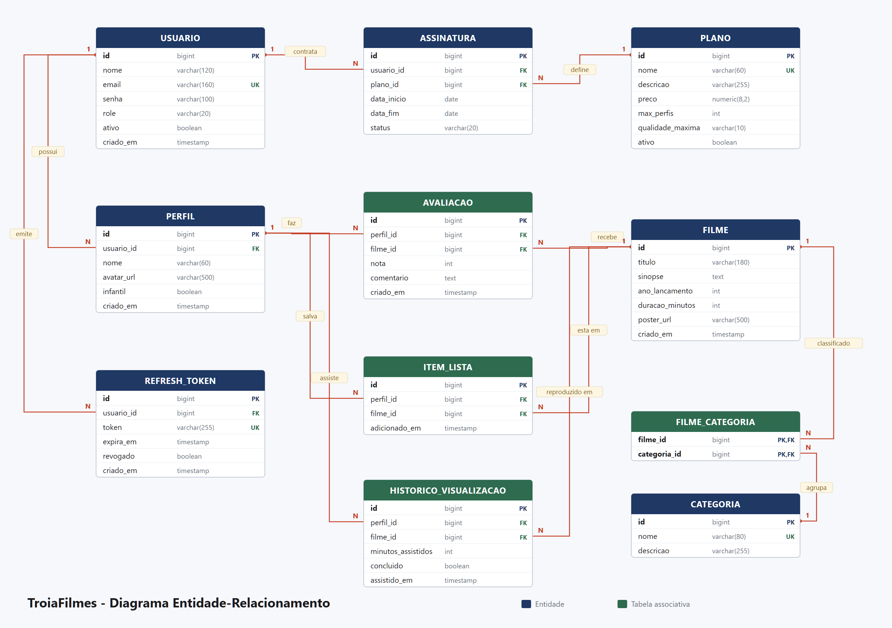

# TroiaFilmes

API REST de um serviço de streaming de filmes, desenvolvida para o **Trabalho 1** da
disciplina de Desenvolvimento Backend com Spring — UNESC.

| | |
|---|---|
| **Instituição** | UNESC — Universidade do Extremo Sul Catarinense |
| **Disciplina** | Desenvolvimento Backend com Spring |
| **Professor** | Matheus Leandro Ferreira |
| **Equipe** | Estefani Ricardo de Souza · Gabrielle Coral · Ingridy Morona Rosa · Kauam Sant'ana |

---

## Sumário

1. [O que é o TroiaFilmes](#o-que-é-o-troiafilmes)
2. [Stack](#stack)
3. [Como rodar](#como-rodar)
4. [Credenciais](#credenciais)
5. [Estrutura de pastas](#estrutura-de-pastas)
6. [Modelo de dados](#modelo-de-dados)
7. [Regras de negócio](#regras-de-negócio)
8. [Segurança](#segurança)
9. [Imagens dos filmes](#imagens-dos-filmes)
10. [Endpoints](#endpoints)
11. [Exemplos de requests e responses](#exemplos-de-requests-e-responses)
12. [Frontend](#frontend)
13. [Testes](#testes)
14. [Configuração](#configuração)
15. [Documentação do trabalho](#documentação-do-trabalho)
16. [Divisão de responsabilidades](#divisão-de-responsabilidades)
17. [Entregas por aula](#entregas-por-aula)

---

## O que é o TroiaFilmes

Um catálogo de filmes no modelo dos serviços de streaming: a pessoa cria uma conta,
assina um plano, mantém **perfis** de consumo dentro dessa conta e, por perfil, avalia
filmes, salva títulos em uma lista e acumula histórico de visualização.

A escolha do domínio não é decorativa. Ela produz naturalmente os dois tipos de
relacionamento exigidos (1:N e N:N) e um conjunto de regras de negócio que vão além do
CRUD — o limite de perfis derivado do plano, a avaliação única por perfil/filme e a
separação entre "o que é do catálogo" (administrado) e "o que é da conta" (privado).

---

## Stack

| Camada | Tecnologia |
|---|---|
| Linguagem | Java 17 (bytecode): compila e roda com JDK 17, 21 ou 25 |
| Framework | Spring Boot 3.5.16 |
| Persistência | Spring Data JPA + Hibernate |
| Segurança | Spring Security + JWT (`java-jwt` 4.4.0 da auth0, HS256) |
| Banco | PostgreSQL 17 |
| Migrations | Flyway |
| Documentação | springdoc-openapi 2.9.1 (Swagger UI) |
| Boilerplate | Lombok 1.18.48 |
| Build | Maven (via Maven Wrapper — não precisa ter Maven instalado) |
| Infraestrutura | Docker Compose (PostgreSQL 17) |
| Frontend | React 19 + Vite + React Router + Axios |

---

## Como rodar

### Pré-requisitos

- **JDK 17 ou superior** (`java -version`)
- **Docker Desktop** (caminho recomendado) ou um **PostgreSQL 12 a 17** local
- **Node.js 20.19+ ou 22.12+** (apenas para o frontend; é o que o Vite 8 exige)

### 1. Subir o banco

#### Opção A — Docker (recomendado)

```bash
docker compose up -d
```

Sobe um PostgreSQL 17 com exatamente o que o `application.properties` espera: banco
`unesc`, usuário `postgres`, senha `lab008r2`, na porta **5432** — os mesmos valores do
arquivo passado em aula. Toda a equipe, e quem for avaliar, obtém o mesmo banco com um
comando só, sem depender do PostgreSQL instalado em cada máquina.

> **A 5432 já está ocupada por um PostgreSQL instalado?** Os dois disputariam a porta e a
> aplicação conectaria no banco errado. Ou pare o serviço (`net stop postgresql-x64-17`,
> em terminal como administrador), ou use outra porta nos dois lados com `DB_PORT`:
>
> ```bash
> DB_PORT=5433 docker compose up -d          # Git Bash / Linux
> ```
> ```powershell
> $env:DB_PORT=5433; docker compose up -d    # PowerShell
> ```
>
> e suba o backend com a mesma variável, no mesmo terminal.

Comandos úteis:

```bash
docker compose ps                              # estado do container
docker compose logs -f db                      # logs do banco
docker compose down                            # para (mantém os dados)
docker compose down -v                         # para e APAGA os dados (recomeça do zero)
docker exec -it troiafilmes-db psql -U postgres -d unesc -c "\dt"   # tabelas criadas
```

#### Opção B — PostgreSQL local

Rode uma única vez, como superusuário:

```bash
psql -U postgres -f docs/criar-banco.sql
```

O script cria o banco `unesc` em UTF-8. Se o usuário ou a senha do seu PostgreSQL não
forem `postgres`/`lab008r2`, informe os seus ao subir o backend, com `DB_USER` e
`DB_PASSWORD`.

**Em qualquer uma das opções, não é preciso criar tabela alguma**: o Flyway aplica as
migrations `V1` a `V6` automaticamente no primeiro boot, incluindo a massa de dados de
demonstração.

> **Se uma migration falhar no meio do caminho**, o PostgreSQL reverte as tabelas, mas
> **não** as sequences — elas são não-transacionais por natureza. Na prática, os ids do
> seed deixam de começar em 1, e os exemplos deste README passam a não bater com o banco.
> Para voltar ao estado limpo: `docker compose down -v && docker compose up -d`.

### 2. Subir o backend

```bash
cd backend
./mvnw spring-boot:run          # Linux/macOS/Git Bash
mvnw.cmd spring-boot:run        # Windows (cmd/PowerShell)
```

A API sobe em **http://localhost:8080**.
O Swagger UI fica em **http://localhost:8080/swagger-ui.html**.

Por padrão a aplicação conecta em `localhost:5432/unesc`. Para apontar para outro banco,
sobrescreva por variável de ambiente:

```bash
DB_HOST=localhost DB_PORT=5433 DB_USER=postgres DB_PASSWORD=suaSenha ./mvnw spring-boot:run
```

> **Windows:** se os acentos saírem trocados no console, rode `chcp 65001` antes.
> É só a codificação do terminal; os dados no banco estão corretos em UTF-8.

### Abrindo numa IDE

O projeto não depende de IDE: é um projeto Maven comum, e as pastas de configuração de
cada IDE (`.idea/`, `.vscode/`, `*.iml`) ficam fora do Git. O único cuidado é abrir a pasta
**`backend`**, onde está o `pom.xml`, e não a raiz do repositório.

| IDE | Como abrir e rodar |
|---|---|
| **IntelliJ IDEA** | *File > Open* e escolha a pasta `backend`. Confie no projeto e espere o Maven importar. Em *File > Project Structure > SDK*, use um JDK 17 ou mais novo. Rode a classe `TroiaFilmesApplication` pelo botão ▶. |
| **VS Code** | Abra a pasta do repositório com o *Extension Pack for Java* instalado; ele encontra o `backend/pom.xml` sozinho. Rode `TroiaFilmesApplication` pelo *Run* acima do `main`. |
| **NetBeans / Eclipse** | Abra (ou importe) `backend` como projeto Maven existente e rode `TroiaFilmesApplication`. |

O Lombok já vem configurado no `pom.xml` como processador de anotações. Se a IDE perguntar
se deve habilitar o *annotation processing*, aceite. Para trocar a porta do banco pela
IDE, informe `DB_PORT` nas variáveis de ambiente da configuração de execução (no IntelliJ:
*Run > Edit Configurations > Environment variables*).

### 3. Subir o frontend

```bash
cd frontend
npm install
npm run dev
```

A interface abre em **http://localhost:5173**. O Vite já encaminha `/api` para
`localhost:8080`, então não é preciso configurar nada além disso.

---

## Credenciais

Todas de demonstração. As contas são criadas pela migration `V5__seed_dados_iniciais.sql`;
o banco, pelo `docker-compose.yml`.

| Onde | Usuário | Senha |
|---|---|---|
| Banco de desenvolvimento | `postgres` | `lab008r2` |

| Papel | E-mail | Senha | O que enxerga |
|---|---|---|---|
| **ADMIN** | `admin@troiafilmes.com` | `Admin@123` | Catálogo, planos e contas |
| **USER** | `usuario@troiafilmes.com` | `User@123` | Perfis, avaliações, lista e histórico próprios |

O usuário de demonstração já vem com plano **Premium**, dois perfis (`Principal` e
`Infantil`), 5 avaliações, 4 filmes na lista e histórico parcial — o suficiente para a
tela de "Continuar assistindo" não nascer vazia.

O catálogo tem **24 filmes** distribuídos em **10 categorias**.

---

## Estrutura de pastas

```
TroiaFilmes/
├── README.md
├── .gitignore, .gitattributes
├── docker-compose.yml                 PostgreSQL 17 (porta configurável por DB_PORT)
│
├── backend/
│   ├── mvnw, mvnw.cmd, .mvn/          Maven Wrapper
│   ├── pom.xml
│   └── src/
│       ├── main/java/br/edu/unesc/troiafilmes/
│       │   ├── TroiaFilmesApplication.java
│       │   ├── config/                SecurityConfig, SecurityFilter, TokenConfig, AuthConfig,
│       │   │                          RespostaJsonDeSeguranca, OpenApiConfig, CORS e uploads
│       │   ├── controller/            11 controllers REST
│       │   ├── service/               11 services (regras de negócio)
│       │   ├── repository/            10 repositories + specification/ + projection/
│       │   ├── entity/                9 entidades + RefreshToken + 3 enums
│       │   ├── dto/request/           11 records de entrada, com Bean Validation
│       │   ├── dto/response/          14 records de saída
│       │   ├── mapper/                conversores entidade -> DTO
│       │   └── exception/             GlobalExceptionHandler + exceções de domínio
│       ├── main/resources/
│       │   ├── application.properties
│       │   ├── static/posters/        24 capas da carga inicial (entram no JAR)
│       │   └── db/migration/          V1 a V6 (Flyway)
│       └── test/java/                 54 testes unitários e de camada web
│   └── uploads/                       imagens enviadas em execução (fora do JAR, fora do Git)
│
├── frontend/
│   └── src/
│       ├── components/                Layout, RotaProtegida, CartaoFilme, Modal...
│       ├── context/                   AuthContext (sessão + perfil ativo)
│       ├── pages/                     Login, Catálogo, DetalheFilme, Planos...
│       │   └── admin/                 painéis de Filmes, Categorias, Planos, Usuários
│       ├── services/api.js            cliente Axios com interceptors de JWT
│       └── index.css
│
└── docs/
    ├── 01-documento-de-analise.docx / .md     documento de análise
    ├── 02-der/                                DER, classes UML e camadas (SVG e PNG)
    ├── 03-prototipo/                          18 capturas da aplicação
    ├── 04-apresentacao.pptx                   deck do pitch (9 slides, com notas do apresentador)
    ├── TroiaFilmes.postman_collection.json    59 requisições, tokens salvos automaticamente
    ├── smoke-test.sh                          61 verificações da API via curl
    └── criar-banco.sql                        criação do banco sem Docker
```

---

## Modelo de dados



**Relacionamentos 1:N** — Usuário→Perfil, Usuário→Assinatura, Plano→Assinatura,
Perfil→Avaliação, Filme→Avaliação, Perfil→ItemLista, Filme→ItemLista,
Perfil→Histórico, Filme→Histórico.

**Relacionamentos N:N** — dois, resolvidos de formas diferentes de propósito:

| N:N | Como foi resolvido | Por quê |
|---|---|---|
| Filme ↔ Categoria | Tabela de junção pura (`filme_categoria`), mapeada com `@ManyToMany` | O vínculo não carrega informação própria |
| Perfil ↔ Filme (Minha Lista) | Entidade associativa `ItemLista` | Precisa guardar `adicionadoEm`, então vira entidade |

Os diagramas de [classes UML](docs/02-der/classes-uml.png) e de
[arquitetura em camadas](docs/02-der/arquitetura-camadas.png) estão em `docs/02-der/`,
junto dos scripts que os geram.

---

## Regras de negócio

O que diferencia o sistema de um CRUD:

| # | Regra | Resposta quando violada |
|---|---|---|
| 1 | Um perfil avalia cada filme **uma única vez** | `409` |
| 2 | Nota entre **1 e 5** | `400` com a lista de campos |
| 3 | Quantidade de perfis limitada pelo **`maxPerfis` do plano vigente** | `409` |
| 4 | **Posse:** um perfil, sua lista, seu histórico e suas avaliações só são acessíveis pelo dono da conta | `403` |
| 5 | **Nota média** e total de avaliações vêm de consulta de agregação, nunca de coluna redundante | — |
| 6 | No máximo **uma assinatura ATIVA** por conta; contratar outro plano cancela a anterior | — |
| 7 | Categoria que ainda **classifica filmes** não é excluída | `409` |
| 8 | Filme marcado como **concluído a partir de 90%** da duração | — |
| 9 | **E-mail único** no cadastro | `409` |
| 10 | **Soft delete:** conta desativada não autentica e tem as sessões revogadas | `401` |
| 11 | Catálogo **paginado e filtrável** por título, categoria e ano (filtros combináveis) | — |

Regras complementares: não é possível migrar para um plano que comporte menos perfis do
que a conta já usa; a conta precisa manter ao menos um perfil; um administrador não
desativa nem rebaixa a própria conta; e o progresso registrado não pode exceder a
duração do filme.

---

## Segurança

Autenticação e autorização acontecem em duas camadas distintas:

**1. Papel (quais rotas você alcança)** — declarado em `SecurityConfig` e reforçado por
`@PreAuthorize` nos controllers.

- `ADMIN` administra o catálogo (filmes, categorias, planos) e as contas.
- `USER` consulta o catálogo e gerencia o que é dele.

**2. Posse (quais registros você toca)** — verificada nos services, em
`PerfilService.buscarComPosse()`.

Vale inclusive para o `ADMIN`: perfil, histórico e avaliações são dados pessoais do
assinante, não itens de catálogo. Um administrador consegue apagar um filme, mas
**não** consegue ler o histórico de outra pessoa — e o smoke test verifica exatamente
isso.

**Login.** A estrutura segue a apresentada em aula: a entidade `Usuario` implementa
`UserDetails` (o login é o e-mail, o papel vira `ROLE_ADMIN`/`ROLE_USER`), o `AuthConfig` é
o `UserDetailsService` e o `AuthenticationManager` confere a senha contra o hash BCrypt. A
mensagem de recusa é a mesma para e-mail inexistente, senha errada e conta desativada,
para a API não revelar quais e-mails têm conta.

**Tokens.** O login devolve um par:

- **token de acesso** — JWT HS256 gerado pelo `TokenConfig` com a biblioteca `java-jwt`,
  validade de 1 hora. Carrega o e-mail (`sub`), o `usuarioId` e o `role`.
- **refresh token** — valor opaco **persistido em banco** (tabela `refresh_token`), validade de 7 dias.

A cada requisição, o `SecurityFilter` lê o header `Authorization: Bearer <token>` e o
`TokenConfig` confere assinatura, emissor (`troiafilmes-api`) e validade. O filtro também
confere a conta: um token emitido antes de a conta ser desativada deixa de valer na hora.

O refresh token não é um JWT de propósito: um JWT assinado vale até expirar e não há
como cancelá-lo. Persistindo o refresh, o logout consegue revogá-lo de fato. Ele também
é **rotacionado**: ao ser usado em `/api/auth/refresh`, é revogado e um novo é emitido,
de modo que um token capturado não continue valendo depois do uso legítimo.

As senhas são gravadas com **BCrypt**; a senha em texto puro nunca é persistida nem
retornada em nenhum DTO.

**Upload de arquivo.** A validação do envio de imagens está descrita em
[Imagens dos filmes](#imagens-dos-filmes) — é a porta de entrada mais exposta da
aplicação e recebeu tratamento próprio.

---

## Imagens dos filmes

São duas origens de imagem, e a separação é proposital.

| Origem | Onde mora | Para quê |
|---|---|---|
| `/posters/*` | `backend/src/main/resources/static/posters` | As 24 capas da carga inicial. Entram no JAR e são versionadas com o código. |
| `/uploads/*` | Pasta externa (`UPLOAD_DIR`, padrão `backend/uploads`) | O que a administração envia depois que a aplicação está no ar. |

A carga inicial não depende de nenhum serviço de imagens na internet: as capas são
servidas pela própria aplicação, então **o catálogo aparece ilustrado mesmo sem rede** —
o que importa na sala de apresentação. Conteúdo enviado em tempo de execução, por outro
lado, fica fora do JAR de propósito: se estivesse dentro, cada novo deploy apagaria o que
os usuários subiram.

As duas rotas são de leitura pública, e isso é uma decisão, não um descuido: a tag ``
do navegador não envia o cabeçalho `Authorization`, então um pôster protegido por JWT
simplesmente não carregaria. São imagens de catálogo, sem nada pessoal. **Enviar** continua
restrito a `ADMIN`.

### Como o envio é validado

```http
POST /api/filmes/9/poster
Authorization: Bearer <token de ADMIN>
Content-Type: multipart/form-data; boundary=...

(campo "imagem" com o arquivo)
```

| Verificação | Por quê |
|---|---|
| O nome enviado é **descartado**; grava-se um UUID | Um nome como `../../application.properties` não tem como escapar da pasta, porque nunca chega ao disco |
| O formato vem dos **bytes iniciais** do arquivo, não do `Content-Type` nem da extensão | Os dois são escolhidos por quem envia. Um texto renomeado para `.jpg` é recusado com `400` |
| Só JPEG, PNG e WebP | Lista de permissão, não de bloqueio |
| Tamanho limitado em **duas camadas** | O container corta em 2 MB (`spring.servlet.multipart`); o service confere de novo, para o caso de alguém afrouxar o limite do container sem lembrar deste ponto |
| Na remoção, só apaga o que está dentro da pasta de uploads | Um `posterUrl` apontando para fora é ignorado em vez de virar exclusão de arquivo do servidor |

Respostas: `200` com o filme atualizado, `400` para arquivo inválido, `403` para quem não é
`ADMIN`, `404` para filme inexistente e `413` acima do limite de tamanho.

### Trocar as capas da carga inicial

As 24 imagens foram baixadas da Wikipédia e normalizadas em JPEG 400×600. Para trocar uma
capa, coloque o arquivo em `static/posters/` e aponte o `poster_url` do filme para ele numa
**migration nova** (`V6__...sql`). A V5 já foi publicada e não pode mais ser editada: o
Flyway se recusa a subir quando um script já aplicado muda.

---

## Endpoints

49 endpoints em 11 controllers. Lista completa e testável no Swagger UI.

### Autenticação — `/api/auth`

| Método | Rota | Acesso | Descrição |
|---|---|---|---|
| POST | `/registrar` | público | Cria a conta (papel USER) no plano Básico e com o perfil Principal; devolve nome e e-mail |
| POST | `/login` | público | Confere e-mail e senha e emite os tokens |
| POST | `/refresh` | público | Renova o token de acesso (rotaciona o refresh) |
| POST | `/logout` | autenticado | Revoga os refresh tokens da conta |

### Minha conta — `/api/conta`

| Método | Rota | Acesso |
|---|---|---|
| GET | `/api/conta` | autenticado |
| PUT | `/api/conta` | autenticado |

### Usuários — `/api/usuarios` (ADMIN)

| Método | Rota | Descrição |
|---|---|---|
| GET | `/api/usuarios` | Lista paginada |
| GET | `/api/usuarios/{id}` | Detalhe |
| PATCH | `/api/usuarios/{id}/situacao?ativo=` | Ativa/desativa (soft delete) |
| PATCH | `/api/usuarios/{id}/papel?role=` | Promove/rebaixa |

### Filmes — `/api/filmes`

| Método | Rota | Acesso | Descrição |
|---|---|---|---|
| GET | `/api/filmes` | autenticado | Busca paginada (`titulo`, `categoriaId`, `ano`, `page`, `size`, `sort`) |
| GET | `/api/filmes/{id}` | autenticado | Detalhe com categorias e nota média |
| GET | `/api/filmes/{id}/avaliacoes` | autenticado | Avaliações do filme, paginadas |
| POST | `/api/filmes` | **ADMIN** | Cadastra |
| PUT | `/api/filmes/{id}` | **ADMIN** | Atualiza |
| DELETE | `/api/filmes/{id}` | **ADMIN** | Remove |
| POST | `/api/filmes/{id}/poster` | **ADMIN** | Envia a imagem de pôster (multipart, campo `imagem`) |
| DELETE | `/api/filmes/{id}/poster` | **ADMIN** | Remove a imagem de pôster |

### Categorias — `/api/categorias` · Planos — `/api/planos`

Mesmo padrão: `GET` para qualquer autenticado, escrita restrita a **ADMIN**.

### Perfis — `/api/perfis`

| Método | Rota | Descrição |
|---|---|---|
| GET | `/api/perfis` | Perfis da conta autenticada |
| GET | `/api/perfis/{id}` | Detalhe (verifica posse) |
| POST | `/api/perfis` | Cria (valida o limite do plano) |
| PUT | `/api/perfis/{id}` | Atualiza |
| DELETE | `/api/perfis/{id}` | Remove (mantém ao menos um) |

### Avaliações · Minha Lista · Histórico

| Método | Rota | Descrição |
|---|---|---|
| GET/POST | `/api/perfis/{perfilId}/avaliacoes` | Lista / cria avaliação |
| PUT/DELETE | `/api/avaliacoes/{id}` | Atualiza / remove |
| GET | `/api/perfis/{perfilId}/lista` | Minha Lista |
| POST/DELETE | `/api/perfis/{perfilId}/lista/{filmeId}` | Adiciona / remove |
| GET | `/api/perfis/{perfilId}/lista/{filmeId}` | Informa se está na lista |
| GET | `/api/perfis/{perfilId}/historico` | Histórico completo |
| GET | `/api/perfis/{perfilId}/continuar-assistindo` | Começados e não concluídos |
| POST | `/api/perfis/{perfilId}/historico` | Registra progresso |
| DELETE | `/api/perfis/{perfilId}/historico/{filmeId}` | Remove do histórico |

### Assinatura — `/api/assinaturas`

| Método | Rota | Descrição |
|---|---|---|
| GET | `/ativa` | Assinatura vigente |
| GET | `/historico` | Histórico de assinaturas |
| POST | `/api/assinaturas` | Contrata ou troca de plano (a anterior é encerrada) |

---

## Exemplos de requests e responses

### Cadastro

```http
POST /api/auth/registrar
Content-Type: application/json

{
  "nome": "Estefani Souza",
  "email": "estefani@exemplo.com",
  "senha": "Senha@123"
}
```

```json
201 Created
{
  "nome": "Estefani Souza",
  "email": "estefani@exemplo.com"
}
```

O cadastro não devolve token: em seguida, entre por `/api/auth/login`. O mesmo e-mail em
outra combinação de maiúsculas é recusado com `409`.

### Login

```http
POST /api/auth/login
Content-Type: application/json

{
  "email": "usuario@troiafilmes.com",
  "senha": "User@123"
}
```

```json
200 OK
{
  "token": "eyJhbGciOiJIUzI1NiIsInR5cCI6IkpXVCJ9.eyJpc3MiOiJ0cm9pYWZpbG1lcy1hcGki...",
  "refreshToken": "3f1c8e0a-...-9b2d4e6f",
  "tipo": "Bearer",
  "expiraEmSegundos": 3600,
  "usuario": {
    "id": 2,
    "nome": "Usuário Demonstração",
    "email": "usuario@troiafilmes.com",
    "role": "USER",
    "ativo": true,
    "criadoEm": "2026-09-20T17:45:12"
  }
}
```

Nas chamadas seguintes, envie o header:

```http
Authorization: Bearer <token>
```

### Buscar no catálogo

```http
GET /api/filmes?titulo=inter&categoriaId=6&page=0&size=12
Authorization: Bearer <token>
```

```json
200 OK
{
  "conteudo": [
    {
      "id": 9,
      "titulo": "Interestelar",
      "sinopse": "Com a Terra se tornando inabitável, um ex-piloto atravessa um buraco de minhoca...",
      "anoLancamento": 2014,
      "duracaoMinutos": 169,
      "posterUrl": "/posters/interestelar.jpg",
      "criadoEm": "2026-09-20T23:59:05",
      "categorias": [
        { "id": 4, "nome": "Drama", "descricao": "Conflitos humanos..." },
        { "id": 6, "nome": "Ficção Científica", "descricao": "Futuros possíveis..." }
      ],
      "notaMedia": 5.0,
      "totalAvaliacoes": 1
    }
  ],
  "pagina": 0,
  "tamanho": 12,
  "totalElementos": 1,
  "totalPaginas": 1,
  "ultima": true
}
```

### Avaliar um filme

```http
POST /api/perfis/1/avaliacoes
Authorization: Bearer <token>
Content-Type: application/json

{
  "filmeId": 3,
  "nota": 5,
  "comentario": "Roteiro impecável."
}
```

```json
201 Created
{
  "id": 6,
  "perfilId": 1,
  "perfilNome": "Principal",
  "filmeId": 5,
  "filmeTitulo": "Bacurau",
  "nota": 5,
  "comentario": "Roteiro impecável.",
  "criadoEm": "2026-09-20T18:02:44"
}
```

### Erro de regra de negócio (avaliação duplicada)

Repetindo a mesma chamada:

```json
409 Conflict
{
  "timestamp": "2026-09-20T18:02:51",
  "status": 409,
  "erro": "Conflict",
  "mensagem": "O perfil Principal já avaliou o filme Bacurau. Edite a avaliação existente para alterar a nota.",
  "caminho": "/api/perfis/1/avaliacoes"
}
```

### Erro de validação

```http
POST /api/perfis/1/avaliacoes
{ "filmeId": 3, "nota": 9 }
```

```json
400 Bad Request
{
  "timestamp": "2026-09-20T18:03:10",
  "status": 400,
  "erro": "Bad Request",
  "mensagem": "Um ou mais campos estão inválidos. Verifique a lista em 'campos'.",
  "caminho": "/api/perfis/1/avaliacoes",
  "campos": [
    { "campo": "nota", "mensagem": "a nota máxima é 5" }
  ]
}
```

### Erro de autorização (USER tentando cadastrar filme)

```json
403 Forbidden
{
  "timestamp": "2026-09-20T18:03:22",
  "status": 403,
  "erro": "Forbidden",
  "mensagem": "Você não tem permissão para executar esta operação.",
  "caminho": "/api/filmes"
}
```

### Erro de posse (acessando perfil de outra conta)

```json
403 Forbidden
{
  "timestamp": "2026-09-20T18:03:35",
  "status": 403,
  "erro": "Forbidden",
  "mensagem": "Este perfil não pertence ao usuário autenticado.",
  "caminho": "/api/perfis/1"
}
```

### Registrar progresso

```http
POST /api/perfis/1/historico
{ "filmeId": 1, "minutosAssistidos": 120 }
```

```json
200 OK
{
  "id": 1,
  "perfilId": 1,
  "filme": { "id": 5, "titulo": "Bacurau", "duracaoMinutos": 132, "...": "..." },
  "minutosAssistidos": 125,
  "percentualAssistido": 95,
  "concluido": true,
  "assistidoEm": "2026-09-20T18:04:02"
}
```

`concluido` virou `true` porque 125 min ≥ 90% de 132 min.

---

## Frontend

SPA em **React 19 + Vite**, em `frontend/`, que consome só a API pública, autenticada por
JWT. O cliente Axios anexa o token em toda requisição e, quando recebe `401`, renova a
sessão com o refresh token uma única vez e repete a chamada, sem a pessoa perceber.


| Área | Telas |
|---|---|
| Acesso | Login (com atalho para as contas de demonstração), cadastro, seleção de perfil |
| Assinante | Catálogo com filtros, detalhe do filme com avaliação, Minha Lista, Continuar assistindo, Planos |
| Administração (só ADMIN) | Filmes (com envio de pôster), Categorias, Planos, Usuários |

As 18 telas, com a descrição de cada uma, estão em
[`docs/03-prototipo`](docs/03-prototipo/README.md), capturadas da aplicação rodando.

---

## Testes

```bash
cd backend
./mvnw test
```

**54 testes**, sem dependência de banco (Mockito + `@WebMvcTest`):

| Classe | O que cobre |
|---|---|
| `TokenConfigTest` | Emissão e validação do JWT, expiração, adulteração, chave trocada e outro emissor |
| `AuthServiceTest` | Cadastro (e-mail repetido, plano Básico e perfil Principal), login recusado e rotação do refresh token |
| `PerfilServiceTest` | Limite de perfis do plano, nome repetido, posse (inclusive negando ADMIN) |
| `AvaliacaoServiceTest` | Avaliação única e propagação da checagem de posse |
| `AssinaturaServiceTest` | Uma assinatura ativa, downgrade bloqueado, plano desativado |
| `HistoricoVisualizacaoTest` | Regra dos 90% e cálculo de percentual |
| `FilmeControllerTest` | 401 sem token, 403 para USER, 201 para ADMIN, 400 com campos |
| `ArmazenamentoServiceTest` | Upload: assinatura do arquivo, limite de tamanho, nome gerado e remoção que não escapa da pasta |

### Verificação da API rodando

Com o backend no ar:

```bash
bash docs/smoke-test.sh
```

São 61 verificações cobrindo o fluxo completo e todos os casos de erro das regras de
negócio, inclusive o cadastro de conta. Cada passo confere o status HTTP esperado.

O roteiro pode ser rodado quantas vezes quiser: ele remove o filme de teste deixado por uma
execução interrompida antes de recriá-lo, e cada execução cadastra um e-mail diferente.

A coleção do Postman (`docs/TroiaFilmes.postman_collection.json`) também roda inteira pela
linha de comando, com as 59 requisições e os testes de cada uma. Rode contra um banco
recém-criado, porque ela cadastra uma conta de e-mail fixo:

```bash
npx newman run docs/TroiaFilmes.postman_collection.json
```

---

## Configuração

O `application.properties` segue o modelo passado em aula. As diferenças estão comentadas
no próprio arquivo; em resumo:

- `spring.flyway.enable` foi corrigido para **`spring.flyway.enabled`**. Escrito errado, o
  Spring ignora a linha sem avisar — funcionava por acidente, já que o Flyway vem ligado
  por padrão.
- Acrescentado `spring.flyway.encoding=UTF-8`, porque os scripts têm acentuação e sem isso
  o Flyway usa a codificação do sistema operacional.
- `ddl-auto=validate`: o Flyway é a única fonte da verdade do schema, e o Hibernate apenas
  confere se as entidades batem com as tabelas. Mexer numa entidade sem a migration
  correspondente impede a aplicação de subir.
- Valores que mudam de máquina para máquina podem ser trocados por variável de ambiente,
  sem editar o arquivo:

| Variável | Padrão | Para quê |
|---|---|---|
| `DB_HOST`, `DB_PORT` | `localhost`, `5432` | Onde está o banco |
| `DB_USER`, `DB_PASSWORD` | `postgres`, `lab008r2` | Credenciais do banco |
| `JWT_SECRET` | chave de desenvolvimento | Chave que assina os tokens. **Defina fora do ambiente de desenvolvimento**: quem conhece a chave fabrica tokens válidos |
| `JWT_EXPIRACAO_SEGUNDOS` | `3600` | Validade do token de acesso |
| `CORS_ORIGINS` | `http://localhost:5173,http://localhost:3000` | Origens do frontend autorizadas |
| `UPLOAD_DIR` | `uploads` | Pasta das imagens enviadas |

---

## Documentação do trabalho

| Entrega do enunciado | Onde está |
|---|---|
| Documento de análise (propósito, responsabilidades, requisitos, UML) | [`docs/01-documento-de-analise.md`](docs/01-documento-de-analise.md) e `.docx` |
| Diagrama de classes e de relacionamento | [`docs/02-der/`](docs/02-der) — DER, classes UML e arquitetura em camadas |
| Protótipo das telas | [`docs/03-prototipo/`](docs/03-prototipo/README.md) — 18 telas |
| Banco de dados (DER e migrations) | [`docs/02-der/der.png`](docs/02-der/der.png) e `backend/src/main/resources/db/migration/` |
| Código-fonte e README | este repositório |
| Apresentação | [`docs/04-apresentacao.pptx`](docs/04-apresentacao.pptx) — 9 slides com notas do apresentador |

---

## Divisão de responsabilidades

Cada integrante é dono de ao menos uma entidade principal, com o CRUD e a lógica de
negócio correspondentes.

| Integrante | Entidades | Entregas |
|---|---|---|
| **Kauam Sant'ana** | Usuário, Plano, Assinatura | Autenticação/JWT, Spring Security, `GlobalExceptionHandler`, regras 6/9/10 |
| **Estefani Ricardo de Souza** | Filme, Categoria | Catálogo, busca paginada com Specification, N:N filme↔categoria, regras 7/11 |
| **Gabrielle Coral** | Perfil, Item de Lista | Checagem de posse, limite de perfis por plano, Minha Lista, regras 3/4 |
| **Ingridy Morona Rosa** | Avaliação, Histórico | Nota média por agregação, avaliação única, continuar assistindo, regras 1/2/5/8 |

---

## Entregas por aula

O enunciado organiza o trabalho em etapas. O que cada uma cobre neste projeto:

| Aula | Data no cronograma | Conteúdo |
|---|---|---|
| 7 | 17/09 | Documento de análise e DER |
| 8 | 24/09 | Migrations do Flyway (V1 a V5) e pacote `entity`, com os relacionamentos 1:N e N:N |
| 9 | 01/10 | Spring Security com JWT: cadastro, login e validação do token |
| 10 | 08/10 | Camadas Controller, Service e Repository, DTOs com Bean Validation e `GlobalExceptionHandler` |
| 11 | 15/10 | Swagger/OpenAPI e ajustes: refresh token, logout, regras por papel |
| 12 | 22/10 | Projeto final: frontend, documentação, testes e apresentação |
