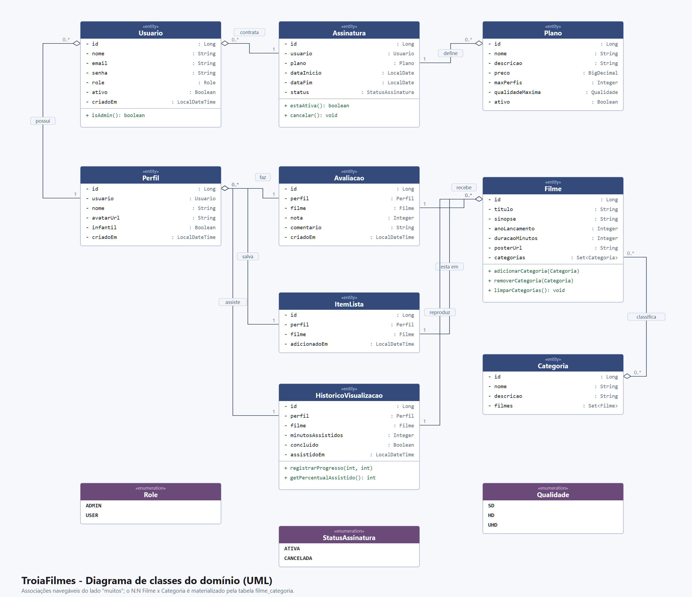
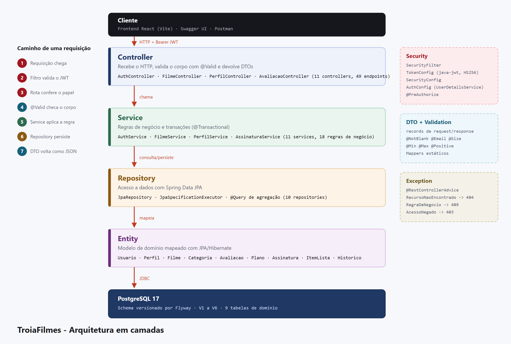

# Documento de Análise — TroiaFilmes

**UNESC — Universidade do Extremo Sul Catarinense**
**Disciplina:** Desenvolvimento Backend com Spring
**Professor:** Matheus Leandro Ferreira
**Trabalho 1 —** Desenvolvimento Backend com Spring Boot

**Equipe:** Estefani Ricardo de Souza · Gabrielle Coral · Ingridy Morona Rosa · Kauam Sant'ana

---

## 1. Nome do sistema e propósito

**TroiaFilmes** é uma API REST para um serviço de streaming de filmes, acompanhada de uma
interface web que a consome.

O sistema atende três públicos dentro do mesmo produto:

- **o assinante**, que mantém uma conta, escolhe um plano e navega pelo catálogo;
- **os perfis dessa conta**, que são quem de fato avalia filmes, salva títulos para
  assistir depois e acumula histórico de reprodução;
- **o administrador**, que cura o catálogo (filmes e categorias), define os planos
  comercializados e administra as contas.

A separação entre conta e perfil é o que dá identidade ao sistema. Ela reproduz o modelo
real dos serviços de streaming — uma assinatura, várias pessoas — e é dela que nascem as
regras mais interessantes do trabalho: o limite de perfis imposto pelo plano contratado e
a distinção entre dado de catálogo (administrável) e dado pessoal (privado, mesmo para o
administrador).

### 1.1 Escopo

**Está no escopo:** cadastro e autenticação de contas; gestão de perfis; catálogo de
filmes organizado por categorias; avaliações com nota e comentário; lista pessoal de
títulos; histórico de visualização com retomada; planos e assinaturas; administração de
catálogo e contas.

**Está fora do escopo:** reprodução real de vídeo (o "assistir" registra progresso, não
transmite mídia), processamento de pagamento e recomendação algorítmica.

---

## 2. Responsabilidades da equipe

Cada integrante é responsável por ao menos uma entidade principal, com o CRUD completo e
a lógica de negócio correspondente, além da parcela proporcional de documentação e testes.

| Integrante | Entidades sob responsabilidade | Entregas técnicas |
|---|---|---|
| **Kauam Sant'ana** | Usuário, Plano, Assinatura | Autenticação e autorização com JWT, configuração do Spring Security, tratamento centralizado de exceções (`@RestControllerAdvice`), migrations do Flyway, regras RN06, RN09, RN10 e RN12 |
| **Estefani Ricardo de Souza** | Filme, Categoria | Catálogo, busca paginada com `Specification`, relacionamento N:N filme↔categoria, agregação de nota média, upload e validação das imagens de pôster, regras RN05, RN07, RN11, RN17 e RN18 |
| **Gabrielle Coral** | Perfil, Item de Lista | Checagem de posse (ownership), limite de perfis derivado do plano, funcionalidade "Minha Lista", regras RN03, RN04 e RN13 |
| **Ingridy Morona Rosa** | Avaliação, Histórico de Visualização | Avaliação única por perfil/filme, cálculo de progresso, prateleira "Continuar assistindo", regras RN01, RN02, RN08 e RN14 |

Responsabilidades compartilhadas por toda a equipe: revisão de código, documento de
análise, protótipo de telas, README e apresentação.

---

## 3. Requisitos funcionais

### 3.1 Autenticação e conta

| Código | Requisito |
|---|---|
| RF01 | O sistema deve permitir que um visitante crie uma conta informando nome, e-mail e senha. A conta nova já nasce no plano Básico e com um perfil "Principal". |
| RF02 | O sistema deve autenticar o usuário por e-mail e senha, devolvendo um token de acesso e um token de renovação. |
| RF03 | O sistema deve permitir renovar o token de acesso sem exigir novo login. |
| RF04 | O sistema deve permitir encerrar as sessões abertas da conta (logout). |
| RF05 | O usuário autenticado deve poder consultar e alterar os próprios dados cadastrais, incluindo a senha. |

### 3.2 Perfis

| Código | Requisito |
|---|---|
| RF06 | O usuário deve poder criar, listar, editar e excluir perfis dentro da sua conta. |
| RF07 | Cada perfil deve possuir nome, avatar opcional e indicação de perfil infantil. |
| RF08 | O sistema deve impedir que um usuário acesse ou altere perfis de outra conta. |

### 3.3 Catálogo

| Código | Requisito |
|---|---|
| RF09 | O administrador deve poder cadastrar, listar, editar e excluir filmes. |
| RF10 | O administrador deve poder cadastrar, listar, editar e excluir categorias. |
| RF11 | Cada filme deve pertencer a uma ou mais categorias. |
| RF28 | O administrador deve poder enviar uma imagem de pôster para um filme e removê-la. |
| RF12 | Qualquer usuário autenticado deve poder consultar o catálogo de forma paginada. |
| RF13 | A consulta ao catálogo deve aceitar filtros combináveis por título, categoria e ano de lançamento. |
| RF14 | O detalhe de um filme deve apresentar suas categorias, a nota média recebida e o total de avaliações. |

### 3.4 Avaliações

| Código | Requisito |
|---|---|
| RF15 | Um perfil deve poder avaliar um filme com nota de 1 a 5 e comentário opcional. |
| RF16 | Um perfil deve poder editar e excluir as próprias avaliações. |
| RF17 | O sistema deve listar as avaliações recebidas por um filme. |

### 3.5 Minha Lista e histórico

| Código | Requisito |
|---|---|
| RF18 | Um perfil deve poder adicionar e remover filmes da sua lista pessoal. |
| RF19 | O sistema deve informar se um filme já está na lista do perfil. |
| RF20 | O sistema deve registrar o progresso de reprodução de um filme por perfil. |
| RF21 | O sistema deve apresentar os filmes começados e não concluídos ("Continuar assistindo"), com o percentual assistido. |

### 3.6 Planos e assinaturas

| Código | Requisito |
|---|---|
| RF22 | O administrador deve poder cadastrar, listar, editar e excluir planos. |
| RF23 | O usuário deve poder consultar os planos disponíveis e contratar um deles. |
| RF24 | O usuário deve poder consultar a assinatura vigente e o histórico de assinaturas, e trocar de plano. |

### 3.7 Administração

| Código | Requisito |
|---|---|
| RF25 | O administrador deve poder listar as contas cadastradas de forma paginada. |
| RF26 | O administrador deve poder ativar e desativar contas. |
| RF27 | O administrador deve poder promover uma conta a administrador ou rebaixá-la. |

---

## 4. Requisitos não-funcionais

| Código | Requisito | Como foi atendido |
|---|---|---|
| RNF01 | A API deve seguir o estilo REST, com verbos e códigos de status HTTP adequados. | 201 para criação, 204 para remoção, 400/403/404/409 para os erros previstos |
| RNF02 | A aplicação deve ser organizada em camadas bem definidas. | Controller → Service → Repository → Entity, com DTO, Validation e ExceptionHandler transversais |
| RNF03 | As entidades de domínio não podem ser expostas diretamente na API. | Todo tráfego de entrada e saída usa DTOs (`records`) |
| RNF04 | As senhas não podem ser armazenadas em texto puro. | Hash BCrypt; a senha nunca aparece em nenhum DTO de saída |
| RNF05 | A API deve ser stateless. | Sem sessão e sem cookie; cada requisição carrega o próprio JWT |
| RNF06 | Os erros devem ter formato único e previsível. | `@RestControllerAdvice` central, com o mesmo corpo `ErroResponse` em toda falha |
| RNF07 | As entradas devem ser validadas antes de chegar à lógica de negócio. | Bean Validation (`@NotBlank`, `@Email`, `@Size`, `@Min`, `@Max`, `@Positive`) |
| RNF08 | O schema do banco deve ser versionado e reproduzível. | Flyway, migrations `V1` a `V6`, com `ddl-auto=validate` |
| RNF09 | Consultas de listagem não podem sofrer com o problema de N+1. | Paginação seguida de hidratação em lote; agregações resolvidas em uma única consulta |
| RNF10 | A API deve ser documentada e testável sem código adicional. | OpenAPI 3 com Swagger UI e autenticação Bearer integrada |
| RNF11 | O ambiente deve ser reproduzível por qualquer integrante. | Docker Compose para o banco e Maven Wrapper para o build |
| RNF12 | O sistema deve registrar as operações relevantes. | SLF4J/Logback nos pontos de negócio e de segurança |
| RNF13 | As regras de negócio críticas devem ser cobertas por testes automatizados. | 54 testes (Mockito e `@WebMvcTest`) mais 61 verificações de integração via script |
| RNF14 | O frontend deve consumir exclusivamente a API pública. | SPA em React, autenticada por JWT, sem acesso direto ao banco |
| RNF15 | Arquivos enviados por usuários devem ser validados pelo conteúdo, e não pelos metadados informados pelo cliente. | Verificação da assinatura de formato nos bytes iniciais, nome gerado pelo servidor e limite de tamanho em duas camadas |
| RNF16 | A demonstração do sistema não deve depender de conexão com a internet. | As imagens do catálogo são servidas pela própria aplicação, a partir dos recursos estáticos |

---

## 5. Regras de negócio

| Código | Regra | Resposta |
|---|---|---|
| RN01 | Um perfil avalia cada filme uma única vez. | `409 Conflict` |
| RN02 | A nota de uma avaliação fica entre 1 e 5. | `400 Bad Request` |
| RN03 | A quantidade de perfis de uma conta é limitada pelo `maxPerfis` do plano vigente. | `409 Conflict` |
| RN04 | Perfil, avaliações, lista e histórico só são acessíveis pelo dono da conta — inclusive para administradores. | `403 Forbidden` |
| RN05 | A nota média de um filme é calculada por agregação, nunca armazenada em coluna redundante. | — |
| RN06 | Cada conta possui no máximo uma assinatura ATIVA; contratar um novo plano cancela a anterior. | — |
| RN07 | Uma categoria que ainda classifica filmes não pode ser excluída. | `409 Conflict` |
| RN08 | Um filme é considerado concluído quando o progresso atinge 90% da duração. | — |
| RN09 | O e-mail é único entre as contas. | `409 Conflict` |
| RN10 | A desativação de conta é lógica (soft delete): o registro permanece, mas a conta deixa de autenticar e tem as sessões revogadas. | `401 Unauthorized` |
| RN11 | Um mesmo título não pode ser cadastrado duas vezes no mesmo ano de lançamento. | `409 Conflict` |
| RN12 | Um administrador não pode desativar nem rebaixar a própria conta. | `409 Conflict` |
| RN13 | Uma conta precisa manter ao menos um perfil. | `409 Conflict` |
| RN14 | O progresso registrado não pode exceder a duração do filme. | `409 Conflict` |
| RN15 | Não é possível migrar para um plano que comporte menos perfis do que a conta já utiliza. | `409 Conflict` |
| RN16 | Um plano com assinantes ativos não pode ser excluído, apenas desativado. | `409 Conflict` |
| RN17 | Só são aceitas imagens JPEG, PNG ou WebP, identificadas pelos bytes iniciais do arquivo e não pelo tipo declarado pelo cliente. | `400 Bad Request` |
| RN18 | Uma imagem enviada não pode exceder 2 MB. | `413 Payload Too Large` |

---

## 6. Modelo de relacionamento (DER)

O modelo tem **9 tabelas de domínio** mais a tabela de junção `filme_categoria` e a
tabela de apoio `refresh_token`.

### 6.1 Relacionamentos 1:N

| Lado "um" | Lado "muitos" | Leitura |
|---|---|---|
| Usuário | Perfil | um usuário possui vários perfis |
| Usuário | Assinatura | um usuário contrata vários planos ao longo do tempo |
| Plano | Assinatura | um plano é contratado por vários usuários |
| Perfil | Avaliação | um perfil faz várias avaliações |
| Filme | Avaliação | um filme recebe várias avaliações |
| Perfil | Item de Lista | um perfil salva vários filmes |
| Filme | Item de Lista | um filme está na lista de vários perfis |
| Perfil | Histórico | um perfil assiste a vários filmes |
| Filme | Histórico | um filme é reproduzido por vários perfis |

### 6.2 Relacionamentos N:N

O sistema tem dois relacionamentos N:N, resolvidos de formas diferentes **de propósito**,
para demonstrar quando cada abordagem é a correta:

| Relacionamento | Solução | Justificativa |
|---|---|---|
| Filme ↔ Categoria | Tabela de junção pura `filme_categoria`, mapeada com `@ManyToMany` | O vínculo não carrega informação própria: só diz que o filme pertence à categoria |
| Perfil ↔ Filme (Minha Lista) | Entidade associativa `ItemLista` | O vínculo carrega atributo próprio (`adicionadoEm`), o que exige uma entidade de verdade |

Essa distinção é um dos pontos que a equipe considera relevante defender na apresentação:
`@ManyToMany` é adequado enquanto a associação for apenas uma ligação; a partir do momento
em que ela ganha atributos, a modelagem correta é promovê-la a entidade.

---

## 7. Diagrama de classes (UML)

O diagrama apresenta as 9 entidades de domínio com seus tipos Java, as 3 enumerações
(`Role`, `StatusAssinatura`, `Qualidade`) e os métodos de negócio que residem na própria
entidade — em vez de vazarem para o service:

- `Assinatura.cancelar()` — encerra a assinatura anterior quando o assinante troca de plano, registrando a data de término;
- `HistoricoVisualizacao.registrarProgresso(int, int)` — grava a posição e reavalia a
  conclusão segundo a regra dos 90%;
- `HistoricoVisualizacao.getPercentualAssistido()` — deriva o percentual para a interface;
- `Filme.adicionarCategoria(...)` / `removerCategoria(...)` / `limparCategorias()` —
  mantêm os dois lados do relacionamento N:N consistentes.

---

## 8. Arquitetura

### 8.1 Responsabilidade de cada camada

| Camada | Responsabilidade | O que **não** faz |
|---|---|---|
| **Controller** | Receber o HTTP, validar o corpo com `@Valid`, delegar ao service e devolver DTOs | Não contém regra de negócio nem acessa repositório |
| **Service** | Aplicar as regras de negócio e controlar a transação | Não conhece HTTP nem monta resposta |
| **Repository** | Consultar e persistir via Spring Data JPA | Não decide nada de negócio |
| **Entity** | Representar o domínio e comportamentos intrínsecos a ele | Não é exposta na API |

Elementos transversais: **Security** (filtro JWT, configuração de rotas e papéis),
**DTO + Validation** (contratos de entrada e saída) e **Exception** (tradução das
exceções de domínio em respostas HTTP).

### 8.2 Caminho de uma requisição

1. A requisição chega ao Tomcat.
2. `SecurityFilter` lê o header `Authorization`, pede ao `TokenConfig` que valide o JWT e popula o contexto de segurança com o `Usuario` dono do token.
3. A cadeia de autorização confere se o papel alcança aquela rota.
4. O controller valida o corpo com `@Valid`.
5. O service aplica a regra de negócio, inclusive a checagem de posse.
6. O repository persiste ou consulta.
7. O mapper converte a entidade em DTO e o controller devolve o JSON.

Qualquer exceção ao longo do caminho é capturada pelo `GlobalExceptionHandler` e sai no
mesmo formato de erro.

---

## 9. Segurança

A autorização acontece em **duas camadas independentes**, e a distinção entre elas é
deliberada:

**Papel — define quais rotas a pessoa alcança.** Declarado em `SecurityConfig` e reforçado
por `@PreAuthorize`. `ADMIN` administra catálogo, planos e contas; `USER` consulta o
catálogo e gerencia o que é seu.

**Posse — define quais registros a pessoa pode tocar.** Verificada nos services, em
`PerfilService.buscarComPosse()`. Vale inclusive para o administrador: perfil, histórico e
avaliações são dados pessoais do assinante, não itens de catálogo. Um administrador
consegue excluir um filme, mas **não** consegue ler o histórico de outra pessoa.

### 9.1 Login

A estrutura segue a apresentada em aula. A entidade `Usuario` implementa `UserDetails`: o
login é o e-mail, a senha é o hash BCrypt e o papel vira a autoridade `ROLE_ADMIN` ou
`ROLE_USER`. O `AuthConfig` é o `UserDetailsService`, que busca a conta pelo e-mail. No
login, o `AuthenticationManager` usa os dois para conferir a senha, e o `TokenConfig` emite
o token.

A resposta de login recusado é a mesma para e-mail inexistente, senha errada e conta
desativada, para a API não revelar quais e-mails têm conta.

### 9.2 Tokens

| Token | Formato | Validade | Revogável |
|---|---|---|---|
| Access token | JWT HS256 gerado com a biblioteca `java-jwt`, autocontido (e-mail no `sub`, `usuarioId`, `role`, emissor `troiafilmes-api`) | 1 hora | Não |
| Refresh token | Valor opaco aleatório, persistido na tabela `refresh_token` | 7 dias | Sim |

O token de acesso é recusado se a assinatura não confere, se venceu, se foi emitido por
outro emissor ou se a conta foi desativada depois da emissão.

O refresh token não é um JWT **por decisão de projeto**: um JWT assinado vale até expirar e
não há como cancelá-lo antes disso. Persistindo o refresh token, o logout consegue
revogá-lo de fato. Ele também é **rotacionado**: ao ser usado, é revogado e um novo é
emitido, de modo que um token capturado não continue valendo depois do uso legítimo.

---

## 10. Decisões técnicas e justificativas

| Decisão | Alternativa descartada | Justificativa |
|---|---|---|
| Spring Boot 3.5 com bytecode Java 17 | Bytecode Java 21 / Spring Boot 4 | Portabilidade: o projeto compila e roda em qualquer JDK 17 ou mais novo. Com bytecode 21, uma máquina com JDK 17 nem compilaria o projeto |
| Mapeamento manual em classes `mapper` | MapStruct | Menos processamento de anotação concorrendo com o Lombok e código que a equipe explica linha a linha |
| `Specification` na busca do catálogo | JPQL com `:param IS NULL` | Evita que o PostgreSQL receba parâmetros sem tipo definido quando o filtro não é informado; o predicado simplesmente não entra na consulta |
| Envelope próprio `PaginaResponse` | Serializar o `Page` do Spring | O formato do `PageImpl` não tem contrato estável entre versões e expõe detalhes internos do framework |
| Paginar e depois hidratar em lote | `@EntityGraph` com `Pageable` | Um join fetch paginado faria o Hibernate paginar em memória; o padrão de duas consultas mantém custo fixo |
| Refresh token opaco em banco | Refresh token como JWT | Só assim o logout revoga de fato a sessão |
| Biblioteca `java-jwt` (auth0) | `jjwt` | É a biblioteca apresentada em aula; a API dela cobre geração, verificação de assinatura, emissor e validade |
| `Usuario` implementando `UserDetails` | Classe adaptadora separada | Estrutura vista em aula; o próprio usuário logado chega aos controllers via `@AuthenticationPrincipal`, sem conversão |
| Chave do JWT em `application.properties`, trocável por variável de ambiente | Chave fixa no código | A chave de produção nunca precisa ser commitada |
| Índice único parcial para a assinatura ativa | Validar apenas no service | O banco garante a regra mesmo sob requisições concorrentes |
| Docker Compose para o banco | PostgreSQL instalado em cada máquina | Toda a equipe e quem for avaliar obtêm o mesmo banco com um comando |
| Imagens do catálogo servidas pela própria aplicação | Endereços de um serviço de imagens na internet | A apresentação não fica dependente da rede da sala, e nenhum endereço externo pode sair do ar no meio da demonstração |
| Formato do arquivo lido dos bytes iniciais | Confiar no `Content-Type` e na extensão | Os dois são escolhidos por quem envia; um executável renomeado para `.jpg` passaria pela validação de metadados |
| Nome de arquivo gerado pelo servidor (UUID) | Preservar o nome original enviado | O nome do cliente nunca toca o disco, então não há caminho relativo capaz de escapar da pasta de destino |
| Uploads em pasta externa ao JAR | Gravar dentro dos recursos da aplicação | Conteúdo de tempo de execução não pertence ao artefato de build; se estivesse dentro, cada deploy apagaria o que foi enviado |

---

## 11. Verificação

| Tipo | Quantidade | Escopo |
|---|---|---|
| Testes unitários (Mockito e JUnit) | 49 | Regras de negócio, cadastro e login, JWT, checagem de posse e validação de arquivos enviados |
| Testes de camada web (`@WebMvcTest`) | 5 | Autorização por papel e formato dos erros de validação |
| Verificações de integração (`docs/smoke-test.sh`) | 61 | Fluxo completo da API rodando, incluindo todos os casos de erro |
| Coleção do Postman (`docs/TroiaFilmes.postman_collection.json`) | 61 | Requisições de todos os endpoints, com testes de status; roda inteira pelo newman |

Os testes automatizados não dependem de banco, o que permite rodá-los em qualquer máquina
sem infraestrutura. A verificação de integração exige a API no ar e descobre todos os
identificadores pela própria API, sem depender de dados fixos.

---

## 12. Referências

- Documentação oficial do Spring Boot 3.5 — https://docs.spring.io/spring-boot/
- Documentação do Spring Security — https://docs.spring.io/spring-security/reference/
- Documentação do Spring Data JPA — https://docs.spring.io/spring-data/jpa/reference/
- Documentação do Flyway — https://documentation.red-gate.com/flyway
- Documentação do PostgreSQL 17 — https://www.postgresql.org/docs/17/
- RFC 7519 — JSON Web Token (JWT) — https://datatracker.ietf.org/doc/html/rfc7519
- Especificação OpenAPI 3.1 — https://spec.openapis.org/oas/v3.1.0

---

*Documento elaborado entre setembro e outubro de 2026 para a disciplina de Desenvolvimento Backend com
Spring — UNESC.*
