# Protótipo de Telas — TroiaFilmes

Entrega 2 do Trabalho 1 — Desenvolvimento Backend com Spring (UNESC).

> **Observação sobre a entrega.** O enunciado pede esboços de tela e diz que a interface
> "não precisa ser funcional". Em vez de wireframes estáticos, a equipe optou por
> construir o frontend de verdade e documentar aqui as **capturas da aplicação em
> execução**, consumindo a API real.

---

## Fluxo principal

### 1. Login

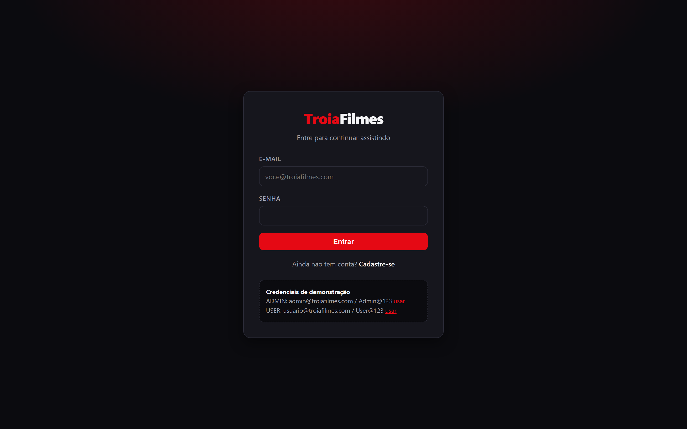

Porta de entrada. As credenciais de demonstração ficam visíveis no próprio cartão, com
botões que preenchem o formulário — útil durante a apresentação. Erros de autenticação
aparecem na faixa vermelha acima dos campos.

### 2. Cadastro

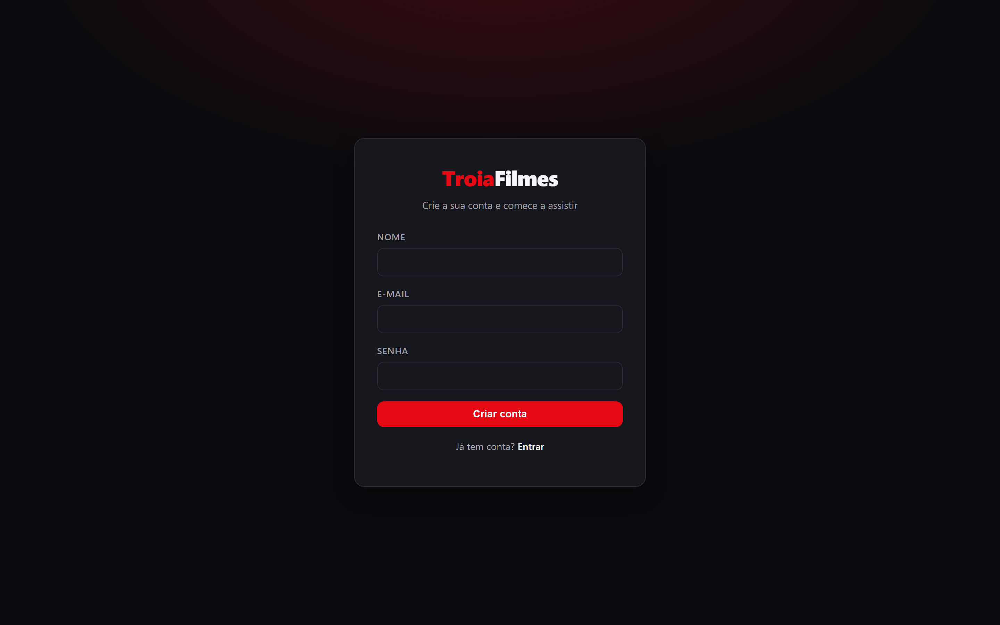

Criação de conta. Ao concluir, o backend já vincula o plano de entrada e cria um perfil
"Principal", de modo que ninguém fique preso em uma conta sem nada utilizável.

### 3. Seleção de perfil

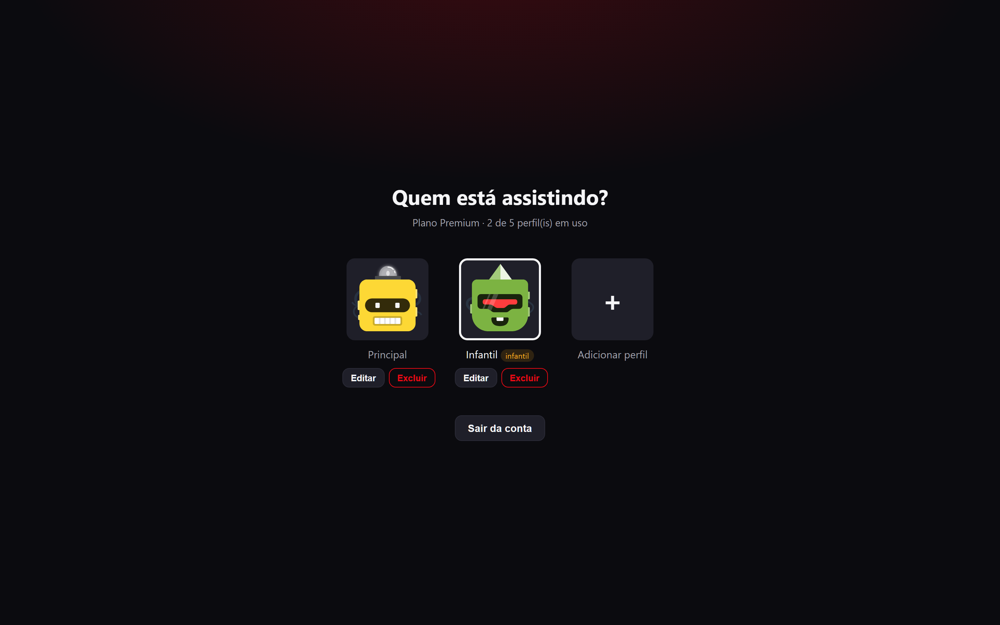

Uma conta, vários perfis. O subtítulo mostra o plano vigente e quantos perfis estão em
uso — **"Plano Premium · 2 de 5 perfil(is) em uso"**. Quando o limite do plano é
atingido, o botão "Adicionar perfil" desaparece e uma faixa orienta a fazer upgrade.
É a regra RN03 visível na interface.

### 4. Catálogo

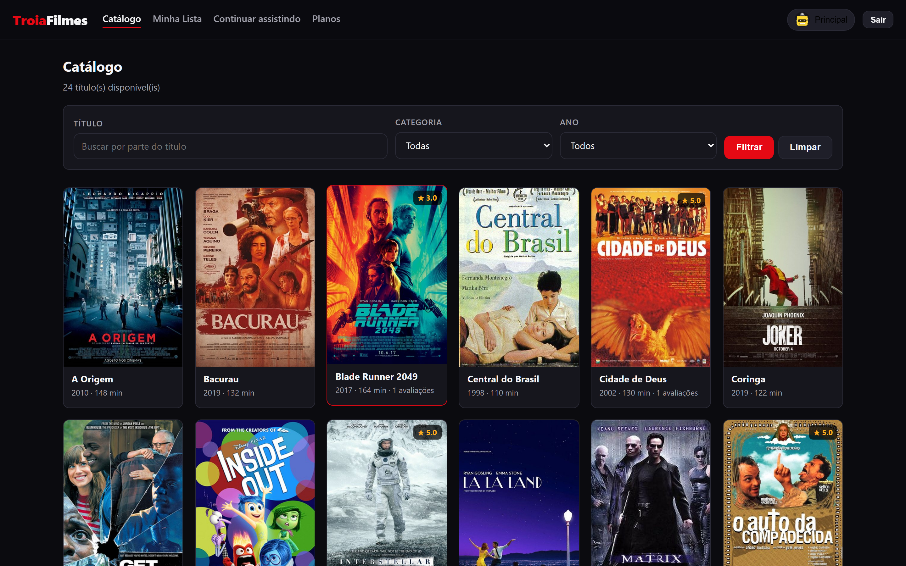

Grade paginada com os três filtros combináveis expostos pela API: título, categoria e
ano. Cada cartão traz a nota média (selo amarelo) e o total de avaliações, ambos vindos
de consulta de agregação.

Os pôsteres são servidos pela própria aplicação, e não por um serviço de imagens na
internet: as 24 capas ficam em `src/main/resources/static/posters` e viajam dentro do
JAR. Na sala de apresentação, o catálogo aparece ilustrado mesmo sem rede.

Por baixo da imagem cada cartão ainda desenha um degradê derivado do próprio título,
com o nome do filme. É o que aparece enquanto a imagem carrega e o que sobra se ela
faltar — nenhum cartão fica vazio.

### 5. Catálogo filtrado

| Por categoria | Por título |
|---|---|
| 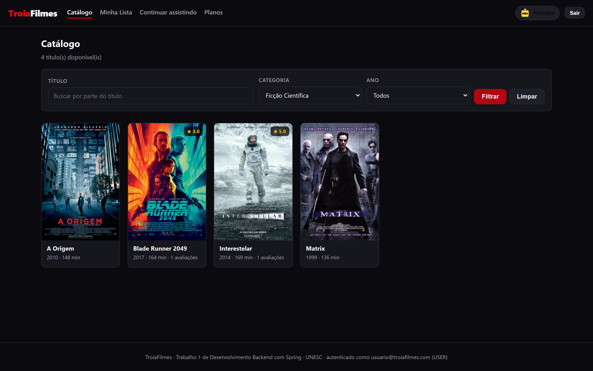 | 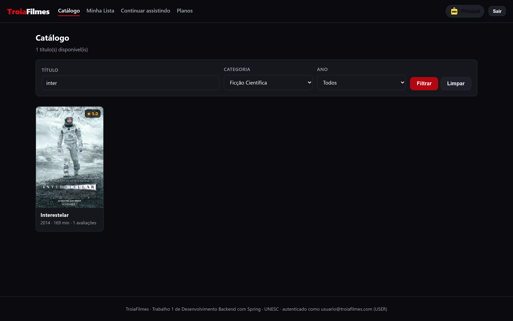 |

Os filtros são acumulativos: dá para combinar título, categoria e ano na mesma consulta.

### 6. Detalhe do filme

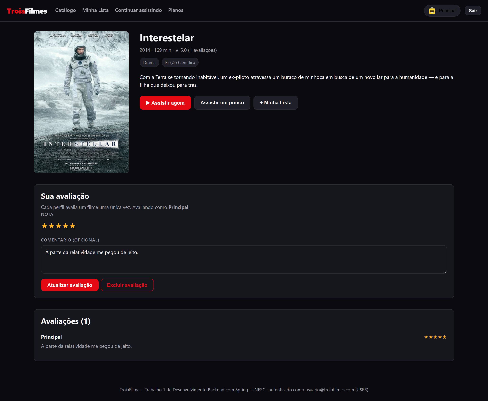

Concentra a maior parte das regras de negócio visíveis ao usuário:

- **Avaliação** com nota de 1 a 5 e comentário. Como o perfil já avaliou este filme, o
  bloco aparece como "Sua avaliação", com as opções de atualizar e excluir — a regra de
  avaliação única (RN01) refletida na interface.
- **Minha Lista** — o botão alterna entre adicionar e remover conforme o estado atual.
- **Assistir agora / Assistir um pouco** — registram progresso de reprodução. O primeiro
  marca como concluído; o segundo para no meio, alimentando "Continuar assistindo".

### 7. Progresso registrado

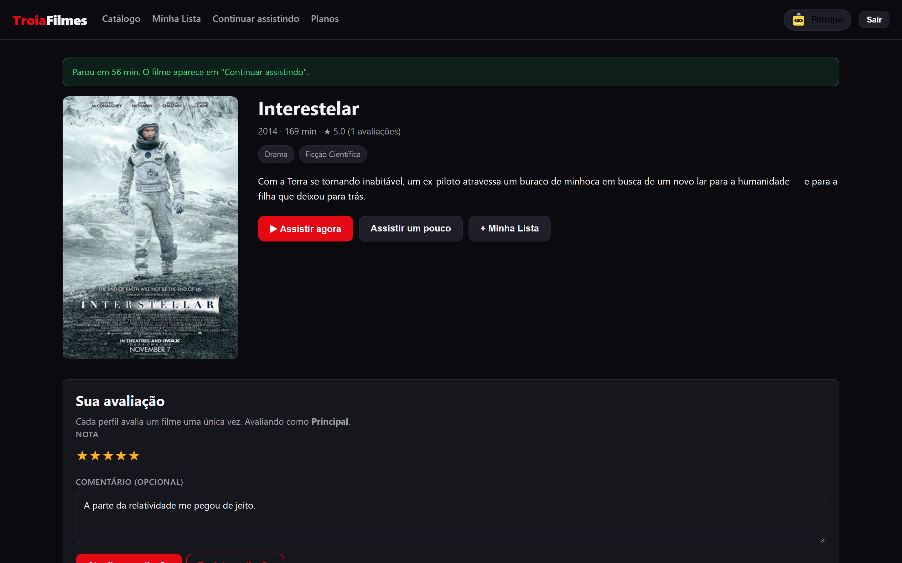

Confirmação de que o progresso foi gravado, com a indicação de onde o filme vai reaparecer.

### 8. Minha Lista

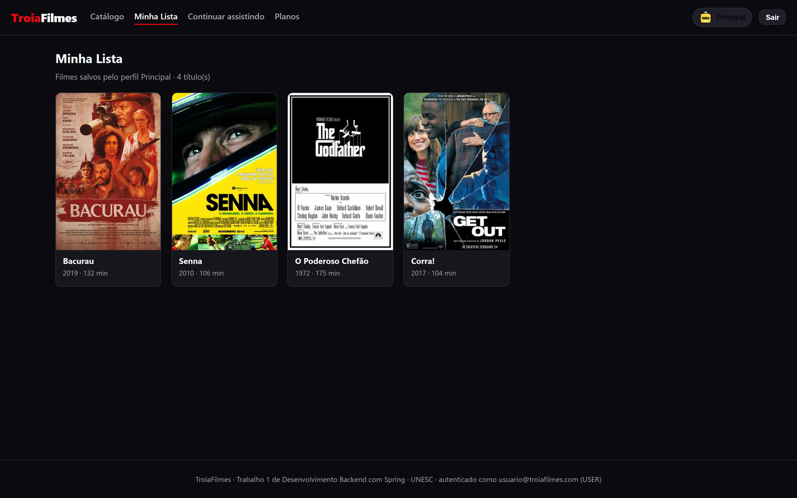

Os filmes salvos pelo perfil ativo, do mais recente para o mais antigo. É o
relacionamento N:N entre perfil e filme resolvido por entidade associativa.

### 9. Continuar assistindo

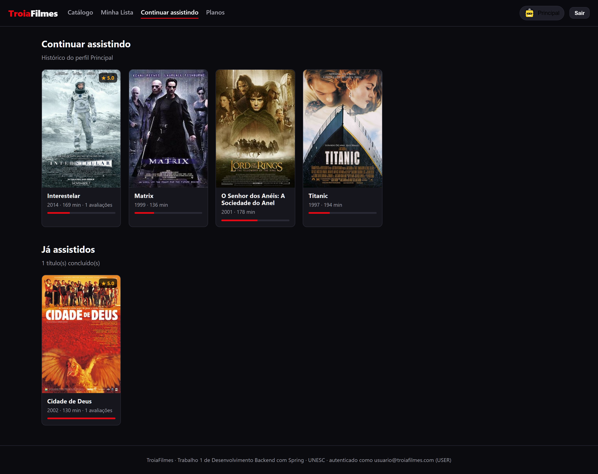

Duas prateleiras: o que está em andamento, com barra de progresso proporcional aos
minutos assistidos, e o que já foi concluído. O corte entre uma e outra é a regra dos
90% (RN08).

### 10. Planos

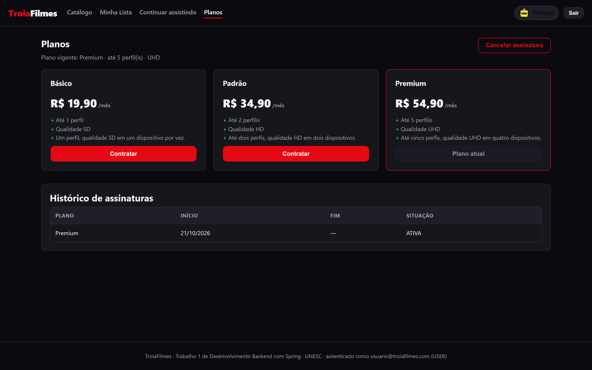

Contratação e troca de plano. Trocar cancela a anterior automaticamente (RN06), e o
histórico de assinaturas fica logo abaixo. Tentar migrar para um plano que comporte
menos perfis do que a conta usa é recusado com a mensagem explicando o motivo (RN15).

### 11. Novo perfil

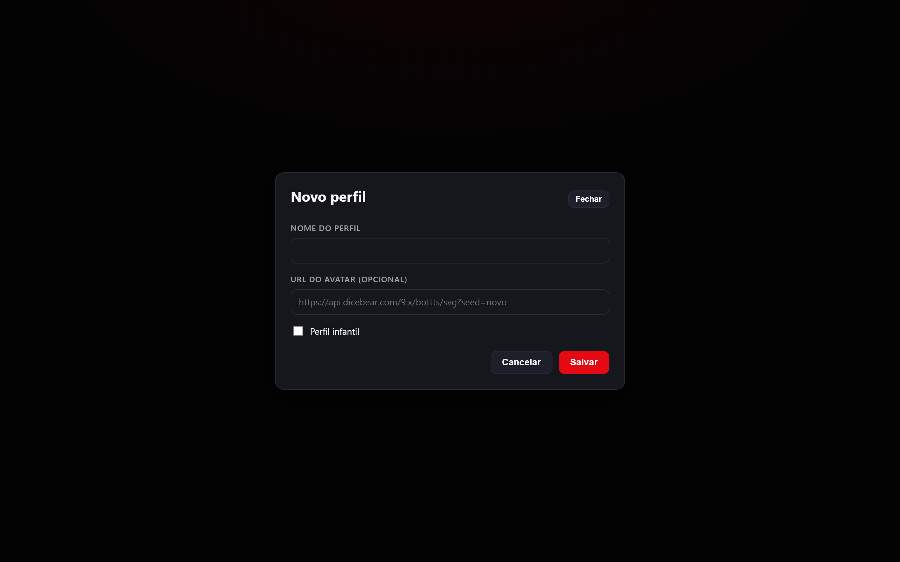

Criação de perfil a partir da seleção de perfis. O limite de perfis vem do plano da
assinatura ativa: com ele atingido, o backend recusa com `409` e a mensagem diz qual é o
limite do plano.

---

## Área administrativa

O item "Administração" só aparece na navegação para contas com papel `ADMIN`. Mesmo que
alguém force a rota, o backend recusa toda operação de escrita com `403`.

### 12. Filmes

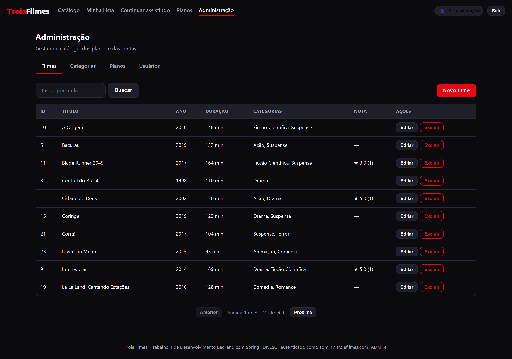

CRUD completo do catálogo, com busca e paginação. A coluna "Categorias" mostra o
relacionamento N:N e a coluna "Nota" traz a média agregada com o total entre parênteses.

### 13. Cadastro de filme

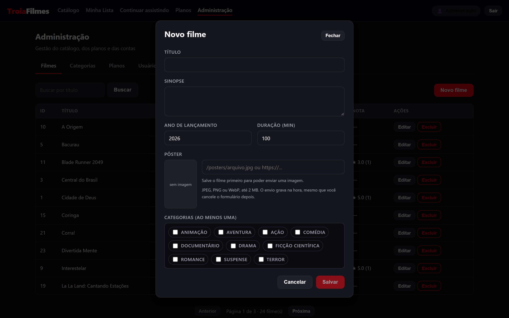

As categorias são selecionadas em múltipla escolha — o formulário não deixa salvar sem
ao menos uma, espelhando a validação `@NotEmpty` do DTO.

### 14. Pôster do filme

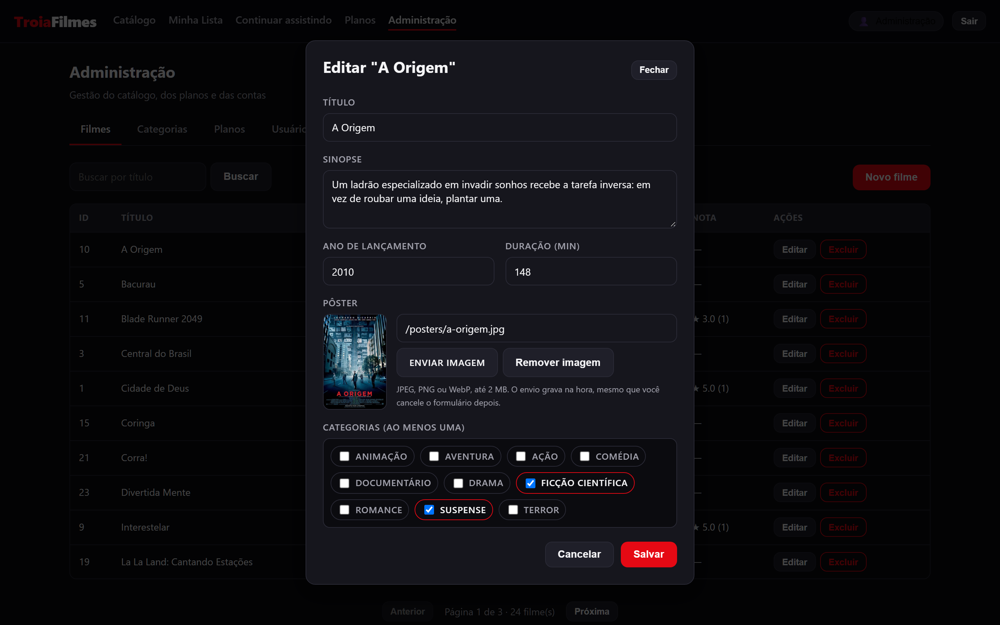

Na edição de um filme já cadastrado aparece o editor de pôster completo: prévia, campo de
endereço e envio de arquivo. O botão **Enviar imagem** aceita JPEG, PNG e WebP de até 2 MB e
grava a imagem na hora, no próprio servidor.

A validação não é só de aparência. O backend ignora o `Content-Type` declarado e a extensão
do nome — os dois são escolhidos por quem envia — e identifica o formato pelos bytes iniciais
do arquivo. Um texto renomeado para `.jpg` é recusado com `400`. O nome original também é
descartado: o arquivo é gravado com um UUID, de modo que um nome como `../../application.yml`
não tem como escapar da pasta de destino.

No cadastro de um filme novo o envio ainda não aparece, e a tela explica o motivo: o endpoint
de upload recebe o id do filme, que só existe depois de salvar.

### 15. Categorias

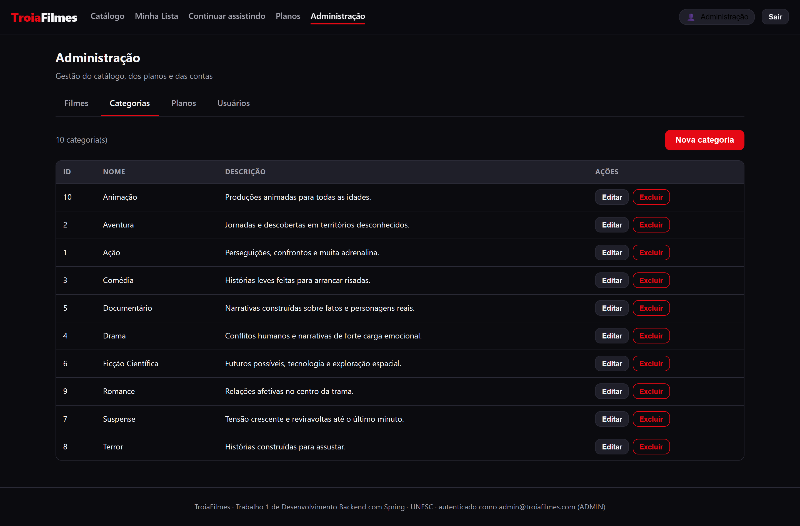

Excluir uma categoria que ainda classifica filmes devolve `409`, e a mensagem do backend
aparece na faixa de erro dizendo quantos filmes dependem dela (RN07).

### 16. Planos

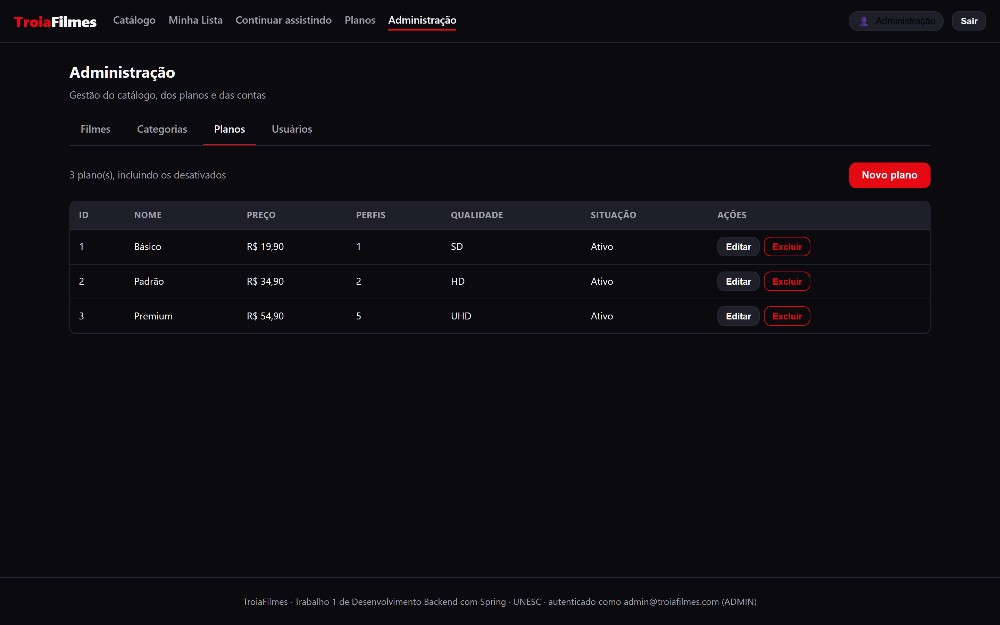

Inclui os planos desativados, que não aceitam novas contratações mas preservam quem já
assinou. Planos com assinantes ativos não podem ser excluídos (RN16).

### 17. Usuários

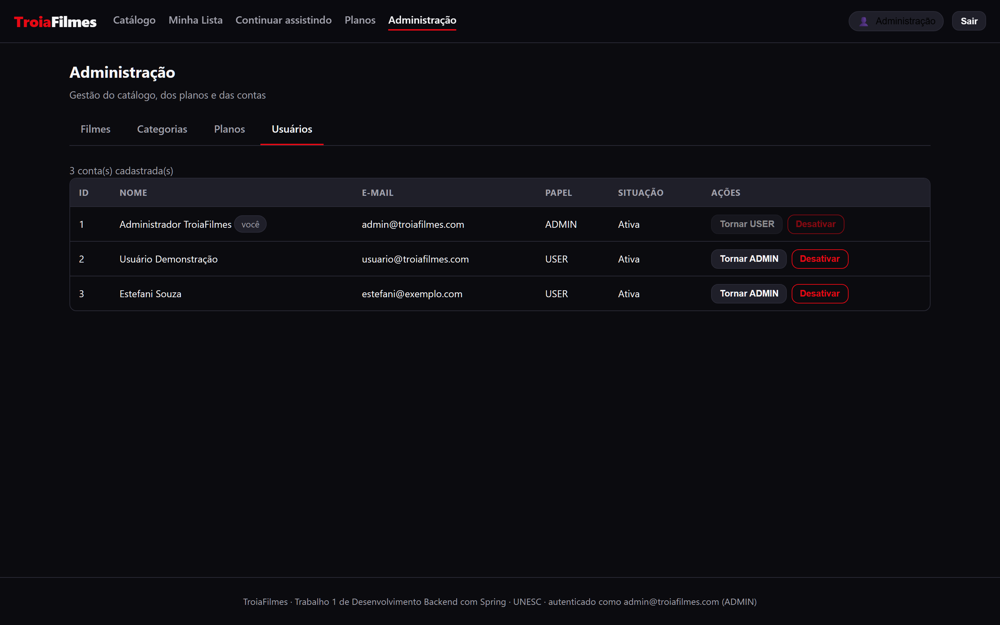

Ativar/desativar contas (soft delete) e promover/rebaixar papéis. As ações sobre a
própria conta ficam desabilitadas, com o motivo no `title` do botão — o backend também
recusa, com `409` (RN12).
